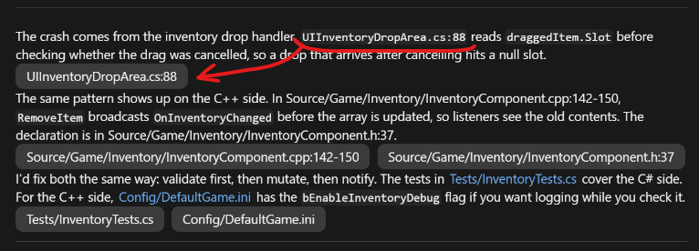

# open-in-ide

Opens code links from Claude's replies in your IDE (JetBrains Rider, Visual Studio or VS Code, or any editor you give a command line for) at the right file and line. Windows only. Made for Unity and Unreal projects first (it picks the right solution or `.uproject` for Rider and Visual Studio), but works for any project.



When a reply mentions a source file (see the supported extensions below), as a link or as plain text (`Foo.cs`, `Source/Foo.cpp:42`, `Foo.cs:88`, `Foo.cs#L10`, `Foo.cs:line 88`, and ranges like `Foo.cs:10-20` or `Foo.cs:10..20`), the mod draws a row of buttons right under the paragraph, list or code block that mentions them. `/open-in-ide buttons end` puts all of a reply's buttons in one row at its end instead, and `/open-in-ide buttons paragraph` switches back.

Simple file name references like `Foo.cs:88` are looked up by name under the session's folder when clicked - the shortest matching path wins.

## Install

```
/plugin install open-in-ide --marketplace NibbleByte/claude-plugins
```

See the [repository README](../../README.md) for adding the marketplace first and for updates.

## Choosing the IDE

Type `/open-in-ide` to see which IDE links open in, and change it with:

- `/open-in-ide auto` (default): whichever of Rider, Visual Studio and VS Code is running, in that order; if none is, the first one installed
- `/open-in-ide rider`
- `/open-in-ide visualstudio`
- `/open-in-ide vscode`
- `/open-in-ide custom <command>`: any other editor, see below. `/open-in-ide custom` alone switches back to the command set before.

The choice is remembered across chats. The **Editor** and **Custom command** plugin options set the same things; the command wins over them.

### Custom command

The command line to run, with these filled in: `{file}` (the full path, backslashes), `{line}`, `{column}` (always 1) and `{folder}` (the session's folder). Quote paths yourself. For example (check the paths against your installs):

| Editor | Command |
| --- | --- |
| Notepad++ | `"C:\Program Files\Notepad++\notepad++.exe" -n{line} "{file}"` |
| Sublime Text | `"C:\Program Files\Sublime Text\sublime_text.exe" "{file}:{line}:{column}"` |
| Cursor | `"%LOCALAPPDATA%\Programs\cursor\Cursor.exe" -g "{file}:{line}:{column}"` (write the path out; variables are not expanded) |
| Zed | `"C:\Program Files\Zed\zed.exe" "{file}:{line}:{column}"` |
| CLion | `"C:\Program Files\JetBrains\CLion\bin\clion64.exe" "{folder}" --line {line} "{file}"` |

It is started the same way as Rider, through WMI, so it runs outside Claude's process tree.

## How each IDE is opened

**Rider** - The mod collects every `.sln`, `.slnx` and `.uproject` from the file's folder upward and uses the nearest one Rider has opened before (from Rider's `recentSolutions.xml`), so a source-built Unreal engine's `UE4.sln` wins over the game's `.uproject` below it; otherwise the nearest `.sln`/`.slnx`, then the nearest `.uproject`. A project with none of these (a web project, say) opens as a folder: the nearest folder above the file that Rider has opened before, else the session's folder, else the file's own folder. It runs `rider64.exe <project> --line N --column 1 <file>`, as Unity's Rider package does. Rider is found from `%LOCALAPPDATA%\JetBrains\Rider<version>\.home`; set the **Rider executable** option to use another install. Rider is started through WMI (`Win32_Process.Create`), because a launcher started from inside Claude's process tree cannot reach an already running Rider.

**Visual Studio** - As Unity's Visual Studio package does: the mod looks in the Running Object Table for a Visual Studio with one of the solutions above the file open, opens the file there and goes to the line. If none has it open, it starts the newest Visual Studio (found with `vswhere`) on the nearest solution and waits up to two minutes for it.

**VS Code** - `Code.exe -g <file>:<line>:1`, which opens the file in the window whose folder holds it. Without a Code.exe in the usual install folders it falls back to a `vscode://file/...` link.
## Notes

- Replies that contain such links are drawn by the mod, so other relative links in those replies show as plain text.
- Supported extensions:
  - C, C++, C#: `.c .cc .cpp .cxx .h .hh .hpp .hxx .inl .ipp .tpp .cs`
  - Shaders: `.usf .ush .shader .compute .cginc .hlsl .hlsli .glsl .vert .frag`
  - Unity and Unreal: `.uxml .uss .asmdef .uplugin .uproject`
  - Other languages: `.java .kt .kts .go .rs .swift .py .rb .php .lua .dart .scala .fs .vb`
  - Web: `.js .jsx .mjs .cjs .ts .tsx .mts .cts .vue .svelte .html .htm .css .scss .sass .less`
  - Scripts, data, config, docs: `.sh .bash .ps1 .psm1 .bat .cmd .sql .json .jsonc .yaml .yml .toml .xml .ini .cfg .conf .csproj .vcxproj .props .targets .gradle .cmake .md .txt`
- Library names written like files, such as `Node.js` or `Vue.js`, get no button unless they have a folder or a line number.
